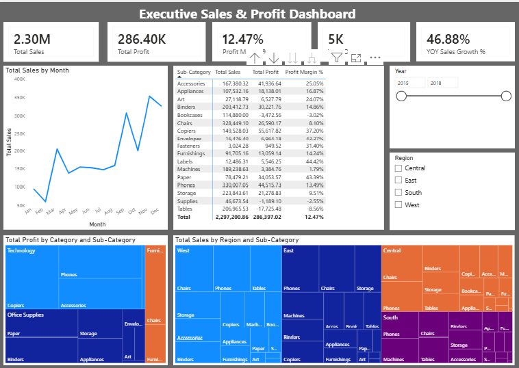

# Task 2: Executive Sales & Profit Dashboard (Power BI)

An interactive one-page Power BI dashboard built on the Superstore sales dataset (9,994 orders, 2015-2018).
## Files
- `Executive_Sales_Profit_Dashboard.pbix`: Power BI report file
- `Executive_Sales_Profit_Dashboard.pdf`: PDF export of the dashboard
- `dashboard.png`: dashboard screenshot
## Data Model
Star schema with one fact table and three dimension tables:
- Fact Orders
- Dim Customer (Customer ID, Customer Name, Segment)
- Dim Product (Product ID, Product Name, Category, Sub-Category)
- Dim Date (created with DAX, marked as date table)

## DAX Measures
- Total Sales, Total Profit, Total Orders
- Profit Margin % = Total Profit / Total Sales
- Sales LY (same period last year)
- YoY Sales Growth %

## Dashboard Contents
- 5 KPI cards: Total Sales, Total Profit, Profit Margin %, Total Orders, YoY Sales Growth %
- Total Sales by Month (line chart)
- Profit by Category and Sub-Category (treemap)
- Sales by Region and Sub-Category (treemap)
- Sub-Category table with Sales, Profit and Margin %
- Year and Region slicers

## Key Numbers (2015-2018)
- Total Sales: 2.30M
- Total Profit: 286.40K
- Profit Margin: 12.47%
- Total Orders: 5,009

## Note on YoY Growth
YoY Sales Growth % compares the selected period with the same period one year earlier. Select a single year in the Year slicer (for example 2018) to see a meaningful year-over-year figure. At the full 2015-2018 range, the card is not a true annual growth rate.

## Tools
Power BI Desktop, Power Query, DAX
